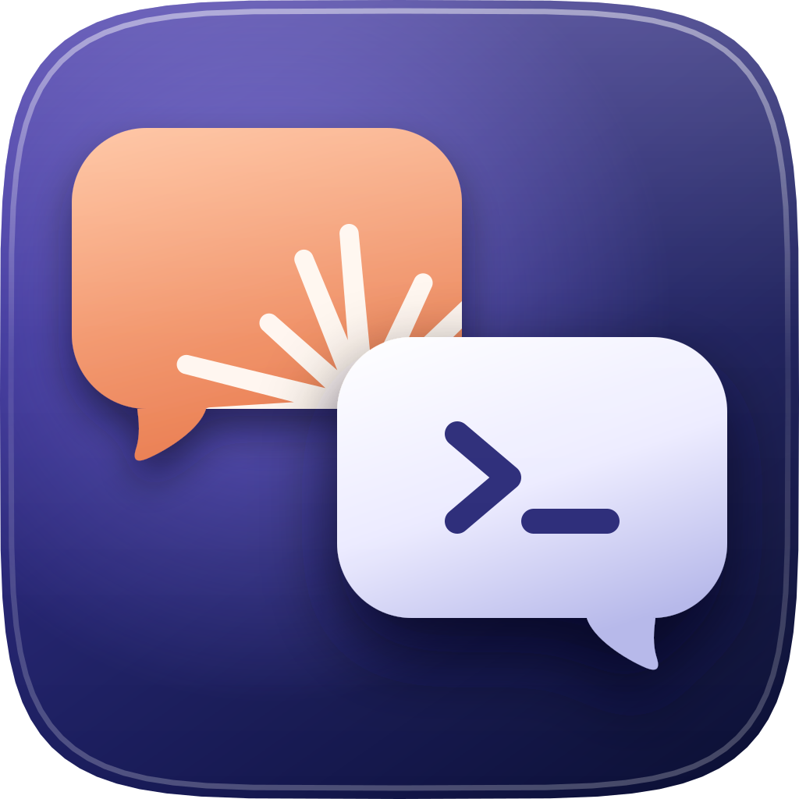

<p align="center">
  
</p>

<h1 align="center">duolog</h1>

<p align="center">
  <a href="https://github.com/lorem-dev/duolog/releases/latest"></a>
  <a href="./docs/getting-started.md"></a>
  <a href="./LICENSE"></a>
  <a href="https://github.com/lorem-dev/duolog/actions/workflows/ci.yml"></a>
</p>

<p align="center">
duolog makes Claude Code and Codex work as a pair in one project. You choose
which agent and model does each kind of work. The sessions talk through a
small file bus, so they do not paste large context at each other.
</p>

---

## How to install the binary

On macOS and Linux:

```sh
curl -fsSL https://github.com/lorem-dev/duolog/releases/latest/download/install.sh | sh
```

On Windows, use Windows PowerShell 5.1 or PowerShell 7:

```powershell
irm https://github.com/lorem-dev/duolog/releases/latest/download/install.ps1 | iex
```

To build from source instead, use Go:

```sh
go install github.com/lorem-dev/duolog/cmd/duolog@latest
```

Both installers verify SHA-256 and select amd64 or arm64. Run the same command
again to update. The default folder is `~/.local/bin` on macOS/Linux and
`$env:LOCALAPPDATA\Programs\duolog` on Windows. The Windows installer adds that
folder to your user PATH (not the machine PATH) when it is missing; set
`DUOLOG_NO_PATH=1` to skip that. The macOS/Linux installer never edits PATH:
add the printed directory yourself if needed. Open a new terminal afterwards.

From the release after 1.4.0 on, the installer attached to a release installs
that release: the `releases/download/v<version>/install.sh` and `install.ps1`
files default to that version, and the `releases/latest/download` links give
the newest release.

To pin a different version on macOS/Linux, or on Windows:

```sh
curl -fsSL https://github.com/lorem-dev/duolog/releases/latest/download/install.sh | sh -s -- --version v1.5.0
```

```powershell
$env:DUOLOG_VERSION = 'v1.5.0'
irm https://github.com/lorem-dev/duolog/releases/latest/download/install.ps1 | iex
```

For custom install folders, plugin updates and shared setup, see
[Getting started](docs/getting-started.md).

## How to install the plugins

The plugins call the binary, so install it first. In Claude Code, run:

```sh
claude plugin marketplace add lorem-dev/duolog
claude plugin install duolog@duolog
```

In Codex, run:

```sh
codex plugin marketplace add lorem-dev/duolog
codex plugin add duolog@duolog
```

## How to install the hooks and approve them

Install hooks for one project or for all your projects:

```sh
duolog install --scope project
duolog install --scope user
```

Codex needs this step because marketplace plugins do not install its hooks.
It then needs one approval in `/hooks` (press `t`) and a trusted project
folder. Claude needs this step only if its plugin is not enabled.

After installing and approving the hooks, start a new Claude Code or Codex
session in your project, so that the agent loads the plugin and the hooks.
That session is the lead. Keep it open while you send tasks.

## How to check the setup

```sh
duolog doctor
```

Follow the steps that doctor names. Local telemetry is on by default; turn it
off with `duolog telemetry off` (see [Telemetry](docs/telemetry.md)).

## How to send the first task

[Getting started](docs/getting-started.md#how-to-send-your-first-task) shows
the task format and what the result line means. Write a task file, such as
`.duolog/task.md`. Then, from the lead session, send it to a role:

```sh
duolog delegate review_intermediate --task .duolog/task.md
```

## License

duolog uses the [Apache License 2.0](LICENSE).

## Related pages

- [Getting started](docs/getting-started.md): install, set up and send a task
- [Configuration](docs/configuration.md): roles, models, defaults and limits
- [Learning mode](docs/learning.md): task classes and routing from local results
- [Calibration](docs/calibration.md): a starting order from past work, on
  request
- [Sync](docs/sync.md): generate one agent's files from the other's
- [Bus](docs/bus.md): messages and artifacts
- [Permissions](docs/permissions.md): how duolog decides for a worker
- [Rex](docs/rex.md): a live second session
- [Budgets](docs/budgets.md): cost targets and what we measured
- [Telemetry](docs/telemetry.md): the local history and how to turn it off
- [Practices and models](docs/research/2026-10-30-practices-and-models.md): the
  evidence behind the default rules
- [Live verification](docs/research/2026-10-30-live-verification.md): which
  agent behavior is OBSERVED and which is VERIFIED
- [How to write the documentation](docs/contributing.md): the writing rules
