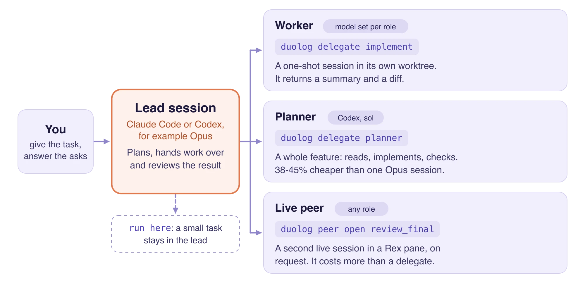

<p align="center">
  
</p>

<h1 align="center">duolog</h1>

<p align="center">
  <a href="https://github.com/lorem-dev/duolog/releases/latest"></a>
  <a href="./docs/getting-started.md"></a>
  <a href="./LICENSE"></a>
  <a href="https://github.com/lorem-dev/duolog/actions/workflows/ci.yml"></a>
</p>

<p align="center">
duolog makes Claude Code and Codex work as a pair in one project. You choose
which agent and model does each kind of work. The sessions talk through a
small file bus, so they do not paste large context at each other.
</p>

<p align="center">
  <picture>
    <source media="(prefers-color-scheme: dark)"
      srcset="/assets/how-duolog-works-dark.webp">
    
  </picture>
</p>

<p align="center">
The <a href="docs/glossary.md#gate">gate</a> checks every worker command
against the project rules. The <a href="docs/glossary.md#bus">bus</a> in
<code>.duolog/</code> carries messages, asks and results.
In our November 2026 study, a lead that gave a whole feature to the
<a href="docs/glossary.md#planner">planner</a> on Codex cost 38-45% less
than one Opus session, with the same test results, on two tasks. Models and
prices change. See the
<a href="docs/research/2026-11-10-hand-over-study.md">study</a>.
</p>

---

## How to install

Run one line in your project folder. It gives Claude Code a short install
prompt; Claude installs duolog and asks whether to set it up for this folder.

On macOS, Linux or WSL:

```sh
claude "$(curl -fsSL https://github.com/lorem-dev/duolog/releases/latest/download/install-prompt.md)"
```

In Windows PowerShell:

```powershell
claude (irm https://github.com/lorem-dev/duolog/releases/latest/download/install-prompt.md)
```

To install with Codex, write `codex` in place of `claude`. Then start a new
session in your project; that session is the lead. Local telemetry is on by
default; turn it off with `duolog telemetry off`.

To install by hand, from source or at a set version, see
[Getting started](docs/getting-started.md).

## How duolog keeps the context small

Each turn re-reads the whole context, so a long session costs more per turn.
duolog makes Claude compact the lead and every Claude worker at a size set by
your plan, instead of at Claude's own default, which on Opus can be the whole
1M-token context.

| Compacts at | Set by duolog for | Opus cost per turn to re-read the context* |
|---|---|---|
| 250k tokens | Pro | 0.05 USD |
| 500k tokens | Max | 0.10 USD |
| 700k tokens | Ultra | 0.14 USD |
| 1M tokens | (Claude's default on Opus) | 0.20 USD |

\* An estimate at the Opus cache price of 0.20 USD per million tokens: near
1M tokens a turn costs about four times what it costs at 250k. We are
measuring the real effect. To change the size, see `workers.compact_window`
in [Configuration](docs/configuration.md#what-workers-inherit).

## How to send the first task

[Getting started](docs/getting-started.md#how-to-send-your-first-task) shows
the task format. Write a task file, such as `.duolog/task.md`, and send it to
a role from the lead session:

```sh
duolog delegate review_intermediate --task .duolog/task.md
```

## License

duolog uses the [Apache License 2.0](LICENSE).

## Related pages

- [Getting started](docs/getting-started.md): install, set up and send a task
- [Glossary](docs/glossary.md): lead, worker, planner, peer and other words
- [Hand-over study](docs/research/2026-11-10-hand-over-study.md): what each
  way of handing work over cost
- [Configuration](docs/configuration.md): roles, models, defaults and limits
- [Permissions](docs/permissions.md): how duolog decides for a worker
- [Rex](docs/rex.md): a live second session
- [Budgets](docs/budgets.md): cost targets and what we measured
- [Telemetry](docs/telemetry.md): the local history and how to turn it off
- [Contributing](docs/contributing.md): the writing rules
